# Pundasyon

[](https://github.com/dmarkdevin/pundasyon/actions/workflows/ci.yml)
[](LICENSE)


*Pundasyon* is Filipino for "foundation". It's an open-source Laravel starter that gives you the parts every app needs, so you can start on what makes yours different: a CRM, an inventory system, a school system or a SaaS.

- **Sign-in and security**: sign-up you can turn off, email confirmation, password reset, two-factor sign-in, account lockout, sign-in history and "log out other devices".
- **Users, roles and permissions**: an admin panel to manage people and what they can do, impersonation, and safeguards against handing out more access than you have.
- **Dashboard, settings and activity log**: permission-aware widgets, settings stored in the database, and a read-only audit trail.
- **Secure REST API**: versioned, token-based, with automatic docs.
- **A module generator**: `php artisan make:module Product --fields="..."` writes the model, migration, admin screens, API, permissions and tests in one go.

MIT licensed. Built with Laravel 13, PHP 8.4 and Filament 5.

**Starting your own app?** Click **Use this template** on GitHub, then read [make it yours](docs/make-it-yours.md) and [building features](docs/building-features.md).

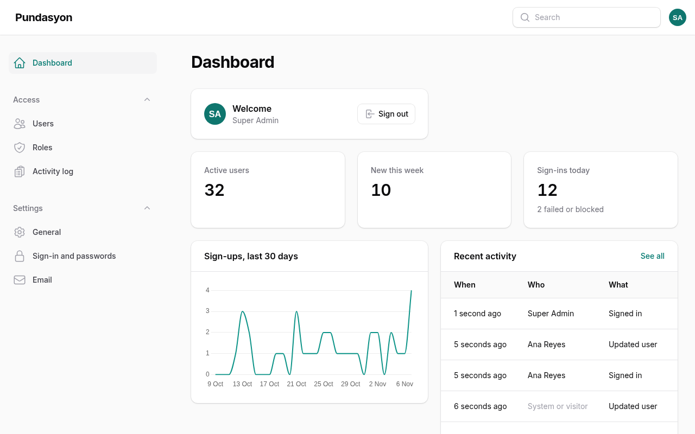

## Contents

- [Screenshots](#screenshots)
- [Requirements](#requirements)
- [Quick start](#quick-start)
- [Everyday commands](#everyday-commands)
- [Adding a module](#adding-a-module)
- [Building features](#building-features)
- [Features](#features)
- [Documentation](#documentation)
- [Contributing and security](#contributing-and-security)

## Screenshots

| | |
|---|---|
| 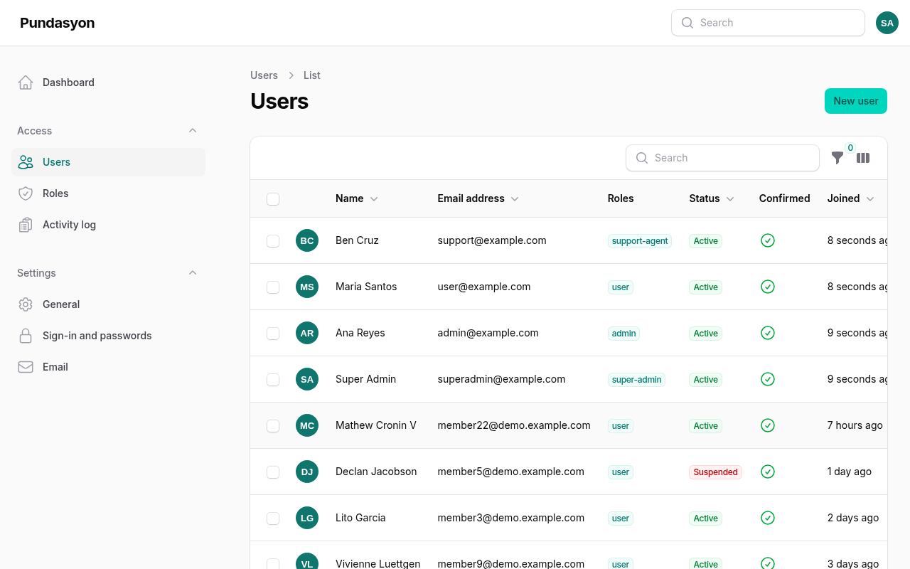 | 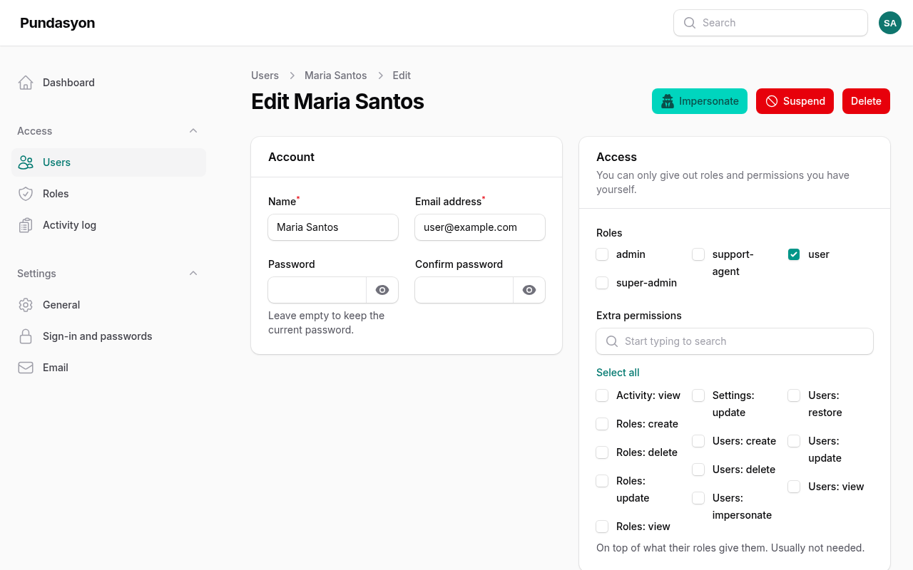 |
| 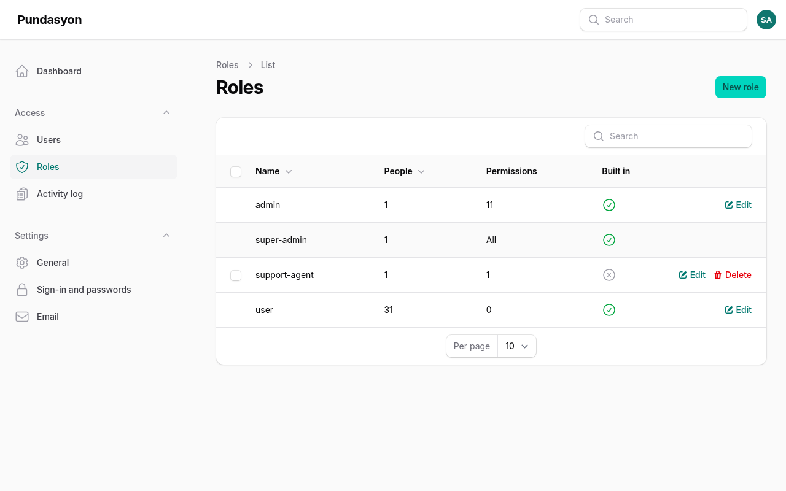 | 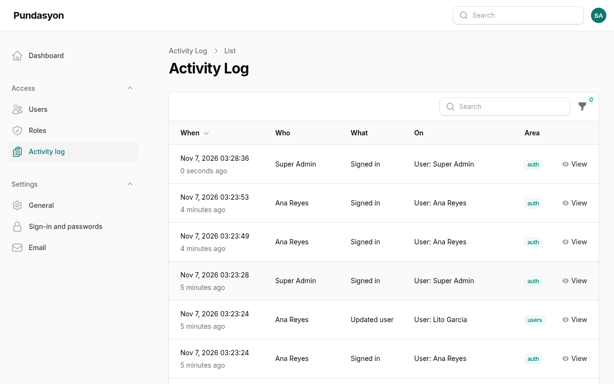 |
| 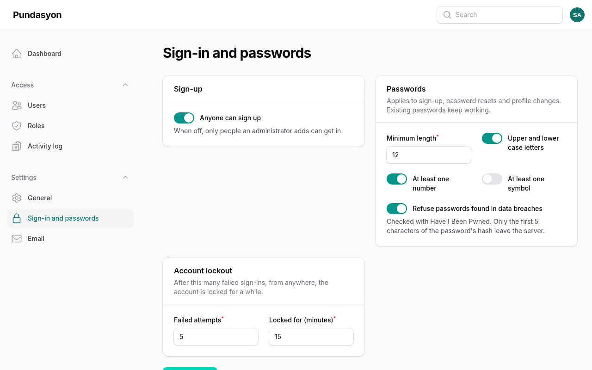 | 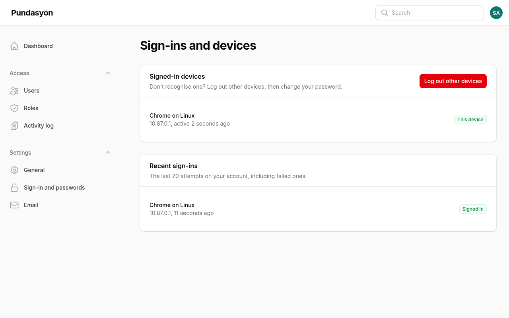 |
| 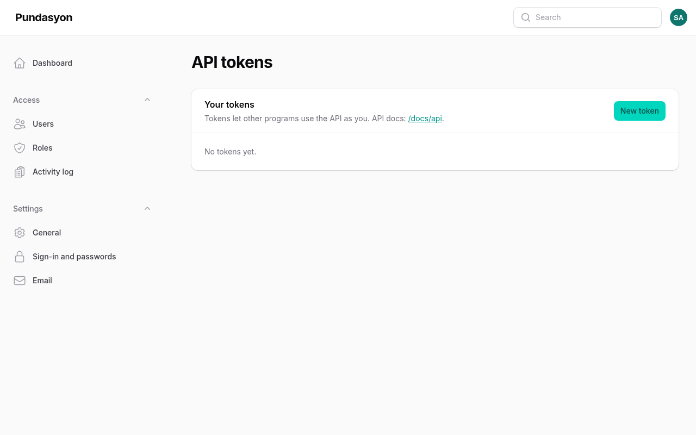 | 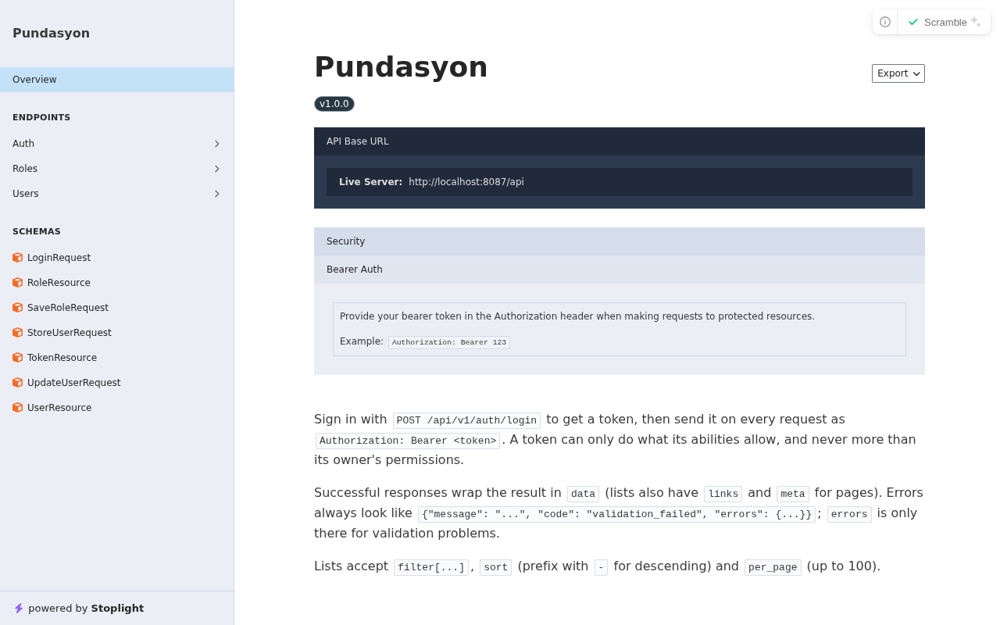 |
| 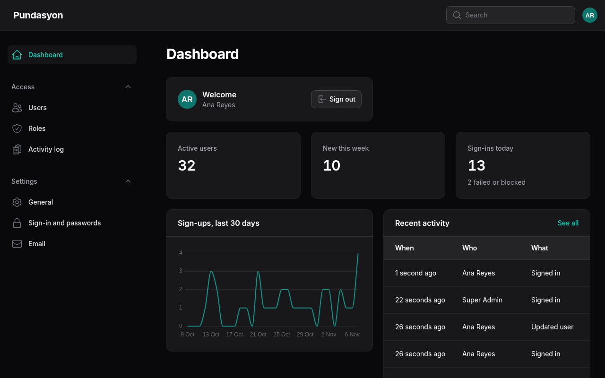 | 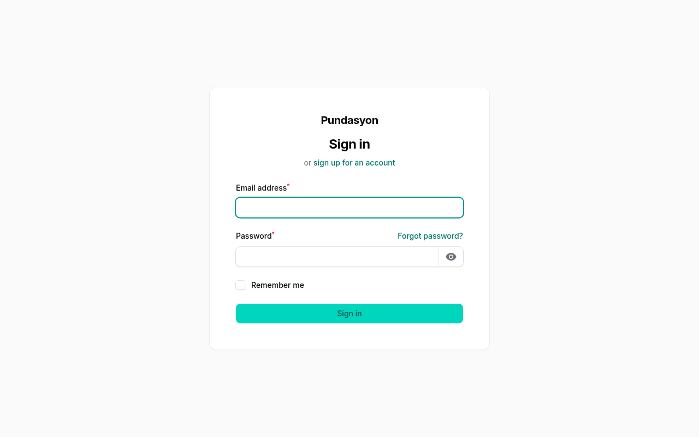 |

## Requirements

- For local development: Docker and Git. PHP, Composer, Node, MySQL and Mailpit run in [Laravel Sail](https://laravel.com/docs/sail) containers.
- For a server: PHP 8.4 with the extensions Laravel 13 needs plus `intl`, `gd` and `pdo_mysql` (or `pdo_pgsql`); MySQL 8 or PostgreSQL 14 or newer; Node 22 to build assets. See [deployment](docs/deployment.md).

## Quick start

```bash
git clone https://github.com/dmarkdevin/pundasyon.git
cd pundasyon
cp .env.example .env

# Install PHP packages with Sail's PHP 8.4 image (no PHP needed on your computer)
docker run --rm -u "$(id -u):$(id -g)" -v "$(pwd):/var/www/html" -w /var/www/html \
    laravelsail/php84-composer:latest composer install --ignore-platform-reqs

./vendor/bin/sail up -d --wait   # --wait: start once MySQL is ready
./vendor/bin/sail artisan app:install --demo
./vendor/bin/sail npm install
./vendor/bin/sail npm run build
```

`app:install` creates the app key, sets up the database, roles and permissions, and asks for your super admin account. Until it has run, the queue container restarts now and then because its tables don't exist yet; that's expected. `--demo` adds sample data and these accounts, all with the password `password`:

| Email | Role |
|---|---|
| `superadmin@example.com` | super-admin: can do everything |
| `admin@example.com` | admin: everything except impersonation |
| `support@example.com` | support-agent: can only view users |
| `user@example.com` | user: no admin access |

| What | Address |
|---|---|
| The app | <http://localhost:8087> |
| Mailpit (every email the app sends) | <http://localhost:8031> |
| API docs | <http://localhost:8087/docs/api> |
| MySQL, from your computer | `127.0.0.1:33087`, user `sail`, password `password` |

Ports taken? Change `APP_PORT`, `FORWARD_DB_PORT`, `FORWARD_MAILPIT_DASHBOARD_PORT` and `APP_URL` in `.env`. If Docker says *"all predefined address pools have been fully subnetted"*, set `SAIL_SUBNET` to an unused range such as `10.88.0.0/24`.

On Windows, run these commands in WSL 2 (Ubuntu) with Docker Desktop's WSL 2 engine.

## Everyday commands

| Command | What it does |
|---|---|
| `./vendor/bin/sail up -d` / `./vendor/bin/sail stop` | Start / stop everything. Data is kept. |
| `./vendor/bin/sail artisan ...` | Run Artisan commands. |
| `./vendor/bin/sail npm run dev` | Rebuild the panel's CSS as you edit. |
| `./vendor/bin/sail composer test` | Run the Pest tests. |
| `./vendor/bin/sail composer format` | Fix code style with Pint. |
| `./vendor/bin/sail composer check` | Style, static analysis (Larastan level 8) and tests, the same as CI. |
| `./vendor/bin/sail composer check:generator` | Prove the module generator still makes working code. |
| `./vendor/bin/sail artisan permissions:sync` | Create new permissions after changing `config/permissions.php`. |

Sail runs the app, a queue worker (it sends the emails), a scheduler (it cleans up old logs and expired tokens), MySQL and Mailpit.

## Adding a module

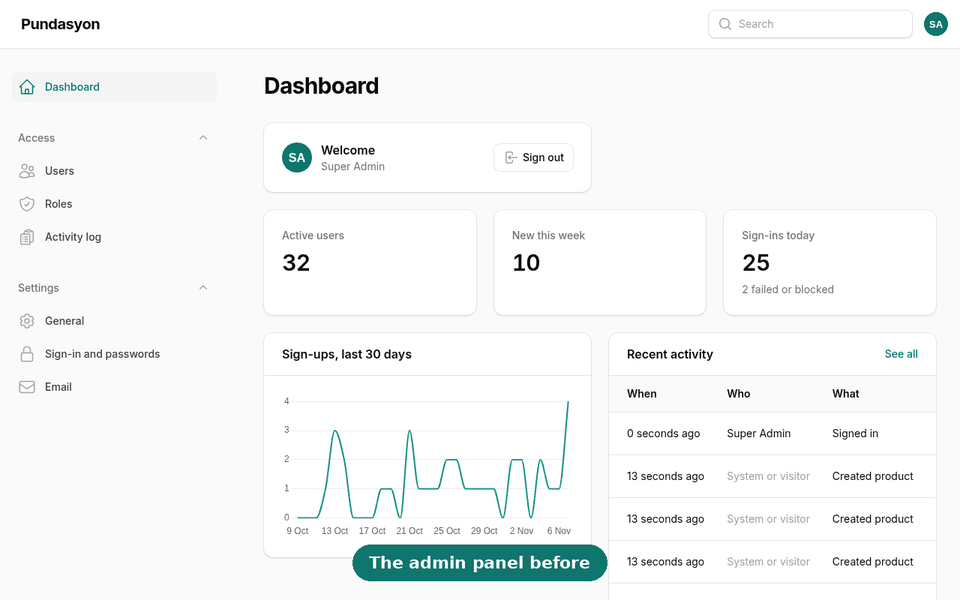

```bash
./vendor/bin/sail artisan make:module Category --fields="name:string:unique" --soft-deletes=false
./vendor/bin/sail artisan make:module Product --fields="name:string,sku:string:unique,price:decimal,stock:integer,is_active:boolean,released_on:date:nullable,category_id:foreignId"
./vendor/bin/sail artisan migrate
./vendor/bin/sail artisan test --filter=Product
```

You get the model, migration, factory, seeder, policy, `products.*` permissions (given to admins at once), admin screens, `/api/v1/products` endpoints and Pest tests, all following the same rules as the rest of the code. `remove:module Product` takes it out again. See [adding a module](docs/modules.md).

## Building features

[Building features](docs/building-features.md) is a step-by-step guide. Every example in it was run and tested against this code:

1. **A CRUD module, then making it yours**: menu groups, validation, a custom "Discontinue" action with its own permission, policy, admin button and API endpoint, a dashboard widget, and tests.
2. **Records people own**: each person sees only their own notes, unless they have `notes.view_all`.
3. **A feature without a module**: an "Export CSV" button on the Users list.
4. **Recipes**: a setting admins can change, a queued email, a scheduled job and API version 2.

It ends with a checklist to go through before opening a pull request.

## Features

**Sign-in and security**
- Sign-up (can be turned off), email confirmation and password reset.
- Two-factor sign-in with an authenticator app and recovery codes.
- Password rules you can change: length, mixed case, numbers, symbols, and refusing passwords found in data breaches.
- Limits per visitor, and an account lockout that stops guessing without letting someone else lock you out.
- Sign-in history and a "Sign-ins and devices" page with "log out other devices".
- Security headers, HTTPS redirects and HSTS in production.

**Users, roles and permissions**
- Create, edit, suspend, reactivate, delete and restore users. Suspending signs them out everywhere and revokes their API tokens.
- Built-in roles `super-admin`, `admin` and `user`, plus any you create. Permissions are named `{module}.{action}`, such as `users.update`.
- A policy for every model. Nobody can give out access they don't have, manage someone with more access, change their own roles, or delete themselves.
- Impersonation for super admins, recorded in the activity log.
- Profile with a private photo, email change confirmation and two-factor set-up.

**Dashboard, settings and activity log**
- Widgets that only show to people with the right permission. Modules can add their own.
- Settings stored in the database and cached: app name and logo, maintenance message, sign-up and password rules, lockout, and mail (SMTP password encrypted).
- An activity log of data changes (before and after), access changes, sign-ins, settings changes and impersonation. Read-only in the app.

**API**
- `/api/v1` with Sanctum tokens limited to chosen permissions, rate limits per token, CORS from `.env`, one JSON format for results and errors, filtering, sorting and paging.
- Interactive docs at `/docs/api`, generated from the code.

**For developers**
- Pest tests (200+), Larastan level 8, Pint, architecture tests, GitHub Actions on SQLite, MySQL and PostgreSQL, and Dependabot.

## Documentation

- [Make it yours](docs/make-it-yours.md): your own copy, renaming, demo data, the licence and staying up to date.
- [Building features](docs/building-features.md): step-by-step tutorials and recipes.
- [Architecture](docs/architecture.md): how the code is organised and why.
- [Adding a module](docs/modules.md): the generator, field types and customising the templates.
- [Permissions](docs/permissions.md): roles, permission names, policies and adding your own.
- [API](docs/api.md): signing in, tokens, endpoints and `curl` examples.
- [Security](docs/security.md): every protection and what it defends against.
- [Deployment](docs/deployment.md): a checklist for running it on a server.
- [Upgrading](docs/upgrading.md): keeping Laravel, Filament and the rest up to date.
- [Security review](docs/security-review.md): the OWASP Top 10 review before v1.0.0.
- [Releasing](docs/releasing.md): the release checklist.

## Contributing and security

Contributions are welcome: [open an issue](https://github.com/dmarkdevin/pundasyon/issues/new/choose) or read [CONTRIBUTING.md](CONTRIBUTING.md) and the [code of conduct](CODE_OF_CONDUCT.md). To report a vulnerability privately, see [SECURITY.md](SECURITY.md). Changes are listed in the [changelog](CHANGELOG.md).

Pundasyon is open source under the [MIT licence](LICENSE).
